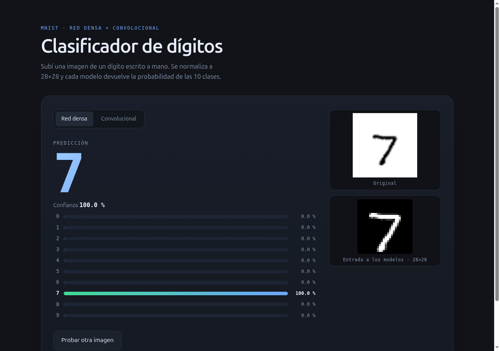

# MNIST: red densa vs convolucional

Dos clasificadores de dígitos entrenados sobre MNIST y servidos en localhost con
una interfaz para subir una imagen y comparar ambas predicciones.



| Modelo | Arquitectura | Parámetros | Test |
| --- | --- | --- | --- |
| Red densa | `784 → 64 → 16 → 10` (relu, softmax) | 51 450 | 97.13 % |
| Convolucional | `Conv2D 32 → Conv2D 64 → Flatten → 10` | 387 466 | 98.70 % |

Las dos arquitecturas son transcripciones literales de las celdas del cuaderno
`MLP_mnist.ipynb`.

## Requisitos

- **Python 3.11–3.13**. TensorFlow todavía no publica ruedas para 3.14; el
  proyecto fija 3.12 en `.python-version` y `uv` lo instala.
- **[uv](https://docs.astral.sh/uv/)** (recomendado) o `venv` + `pip`.
- **Opcional**, solo para entrenar en Kaggle: cuenta de Kaggle y su CLI.

## Puesta en marcha

```bash
git clone <repo> && cd Actividades/1-Mnist
uv sync                 # crea .venv con Python 3.12 e instala dependencias
uv run mnist-serve      # http://127.0.0.1:5000
```

Con `venv` + `pip` (versiones exactas del `uv.lock`, incluido `pytest`):

```bash
python3.12 -m venv .venv
source .venv/bin/activate
pip install -r requirements.txt
```

`requirements.txt` está generado: si cambian las dependencias, se regenera con
`uv export --no-hashes -o requirements.txt` (no se edita a mano).

La URL se abre en el navegador; la imagen se arrastra (o se pega con `Ctrl+V`) y
se cambia de pestaña para comparar la red densa con la convolucional. Cada panel
muestra la predicción, la confianza, la distribución completa y la imagen de
28×28 que entra a los modelos. Los artefactos ya están en `models/`, así que no
hace falta entrenar nada para usar la aplicación.

### Opciones del servidor

```bash
uv run mnist-serve --host 0.0.0.0 --port 5000   # accesible desde la red local
```

- Por defecto escucha en `127.0.0.1` (solo esta máquina).
- Con `--host 0.0.0.0` imprime la IP de la LAN. Si el firewall la bloquea, se
  habilita con `sudo ufw allow 5000/tcp`.
- `--dense RUTA` y `--conv RUTA` permiten cargar otros artefactos.
- La imagen se procesa en memoria: no se escribe nada en disco.

## Reproducir el entrenamiento

### En local

```bash
uv run mnist-train --model dense   # ~1 min en CPU
uv run mnist-train --model conv    # ~10 min en CPU (19 s por época)
```

Se guardan `models/mnist_mlp.keras` / `models/mnist_cnn.keras` junto a su
`*.metrics.json`. Si el `.keras` ya existe, el comando no reentrena; `--force` lo
regenera.

| Opción | Efecto |
| --- | --- |
| `--model dense\|conv` | Arquitectura a entrenar (default: `dense`). |
| `--where pc\|kaggle` | Dónde corre (default: `pc`). |
| `--epochs`, `--batch-size`, `--seed` | Hiperparámetros (default: 30, 32, 0). |
| `--out RUTA` | Ruta del artefacto (solo en local). |
| `--force` | Reentrena aunque el artefacto exista. |

### En la nube (Kaggle)

Una sola vez, para autenticar el CLI:

```bash
uv tool install --python 3.12 --with six kaggle
kaggle auth login
```

Después, el mismo comando con `--where kaggle`:

```bash
uv run mnist-train --model conv --where kaggle
```

Eso hace, en orden:

1. Arma un dataset privado con el repo (`src/` y el `mnist.npz` cacheado) y lo
   sube. **Solo crea una versión nueva si el código o los datos cambiaron** (lo
   decide un hash), así que entrenar otro modelo no vuelve a subir 11 MB.
2. Genera un lanzador y su metadata, y hace *push* de un kernel privado por
   modelo (`<usuario>/mnist-<modelo>-training`, el usuario sale de
   `kaggle config view`) con GPU T4 e **internet apagado** (MNIST viaja dentro
   del dataset).
3. Espera el estado `COMPLETE` y descarga la salida a `models/`.
4. Si falla, imprime el log del kernel.

El kernel importa el paquete desde `/kaggle/input/mnist-repo/src`, así que corre
**exactamente el mismo código** que el entrenador local; el artefacto es
comparable sin importar dónde se entrenó.

`--no-wait` deja la corrida lanzada y termina. Para seguirla o descargarla a mano:

```bash
kaggle kernels status <usuario>/mnist-conv-training
kaggle kernels output <usuario>/mnist-conv-training -p models
```

Límites de la plataforma: 12 h por corrida, 20 GB en `/kaggle/working` y 30 h de
GPU por semana (`kaggle quota`). Cada push crea una versión nueva del kernel.

### Agregar otro modelo

1. El builder se escribe en `src/mnist_app/model.py` (junto a `build_dense` y
   `build_cnn`) y se registra en `BUILDERS` y `MODEL_FILES`.
2. `uv run mnist-train --model <clave>` lo entrena en local.
3. `uv run mnist-train --model <clave> --where kaggle` crea el kernel
   `mnist-<clave>-training` la primera vez, sin tocar nada más.

No hace falta un repo ni un dataset por modelo: el dataset es del proyecto y se
versiona solo; cada modelo es un kernel que lo consume.

### Verificar un artefacto

```bash
uv run mnist-predict ruta/a/digito.png                # red densa
uv run mnist-predict ruta/a/digito.png --model conv   # convolucional
```

## Estructura

```text
1-Mnist/
├── MLP_mnist.ipynb         Cuaderno original del curso
├── pyproject.toml          Dependencias y entry points
├── requirements.txt        Export para pip (generado desde uv.lock)
├── docs/preview.png        Captura de la interfaz
├── models/                 Artefactos entrenados (.keras) y métricas
├── src/mnist_app/
│   ├── model.py            Arquitecturas (densa y CNN) + carga de artefactos
│   ├── data.py             MNIST (acepta un .npz local para correr offline)
│   ├── preprocess.py       Imagen → 28×28 tipo MNIST
│   ├── predict.py          Inferencia (MLP o CNN) + CLI
│   ├── train.py            Entrenamiento local/Kaggle (punto de entrada único)
│   ├── kaggle.py           Dataset versionado + kernel por modelo
│   ├── app.py              Servidor Flask
│   ├── templates/          Página de carga
│   └── static/             CSS y JS
└── tests/
```

`build/` es staging generado (dataset y kernel) y está ignorado por git.

## Por qué no hay que reentrenar

Un `.keras` es un archivo autocontenido: arquitectura (`config.json`), pesos y
estado del optimizador (`model.weights.h5`). El servidor solo lo carga al arrancar
(`load_model`) y hace forward pass por cada imagen; entrenar es un paso aparte que
ocurre una vez. Los artefactos están versionados en `models/` (~5 MB) justamente
para que clonar el repo alcance.

## Preprocesado

Porta el preprocesado del cuaderno, con dos ajustes para fotos reales: la
detección de fondo claro usa la mediana del borde (las cuatro esquinas se engañan
con una sombra) y una imagen sin trazos devuelve un error claro.

1. Escala de grises y composición sobre blanco si hay transparencia.
2. Inversión si el fondo es claro.
3. Binarización con Otsu.
4. Se conserva la componente conectada más grande (el dígito).
5. Recorte al rectángulo del trazo y escalado a 20×20 conservando proporción.
6. Pegado centrado en un lienzo negro de 28×28.
7. Centrado por centro de masa, como pide el paper de MNIST.

## Pruebas

```bash
uv run pytest
```

Cubren el preprocesado (transparencia, fondo oscuro, imagen vacía), las dos
arquitecturas, la inferencia con entrada `784` y `28×28×1`, la carga offline del
`.npz`, el endpoint con ambos modelos y la metadata del kernel de Kaggle.

## Problemas comunes

| Síntoma | Causa y solución |
| --- | --- |
| `No module named 'tensorflow'` en Python 3.14 | TF no soporta 3.14; usar `uv sync` (respeta `.python-version`). |
| `Model already exists ...` | Es intencional: agregar `--force` para reentrenar. |
| `kaggle` falla con `No module named 'six'` | `uv tool install --with six kaggle` (el paquete no lo declara). |
| `No active account` | `kaggle auth login` (abre el navegador). |
| La página no abre desde otra máquina | Usar `--host 0.0.0.0` y abrir el puerto en UFW. |
| El kernel falla por internet | Debe quedar `enable_internet: false`; MNIST viaja en el dataset. |

## Notas

- El cuaderno `MLP_mnist.ipynb` queda como referencia del curso; la versión
  ejecutable es este proyecto.
- Sobre 200 imágenes de test, el pipeline completo acierta 97.0 % (densa) y
  98.0 % (CNN); el modelo directo, 98.5 % y 99.0 %. La binarización y el
  recentrado cuestan alrededor de un punto.
- Son modelos pequeños: funcionan bien con dígitos centrados y contraste alto.
  Por eso la interfaz muestra la distribución completa de probabilidades.
